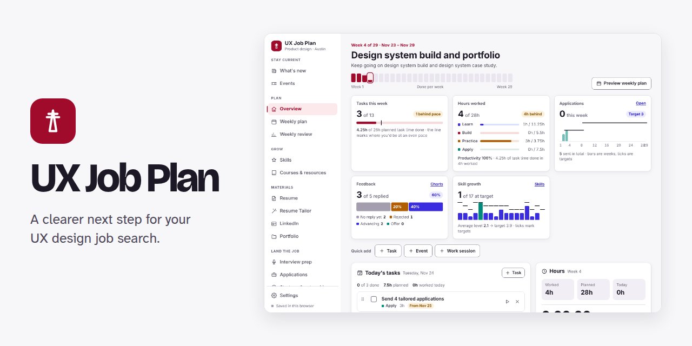
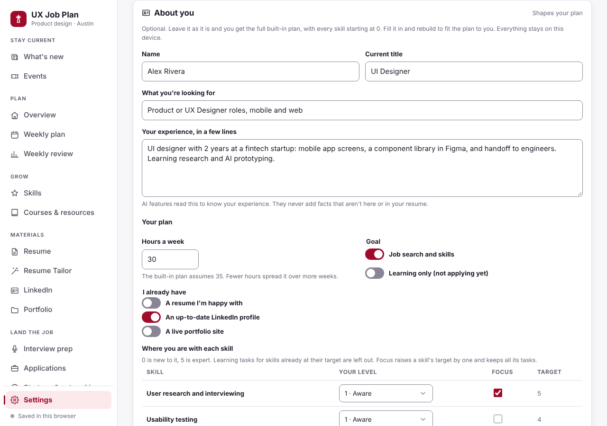
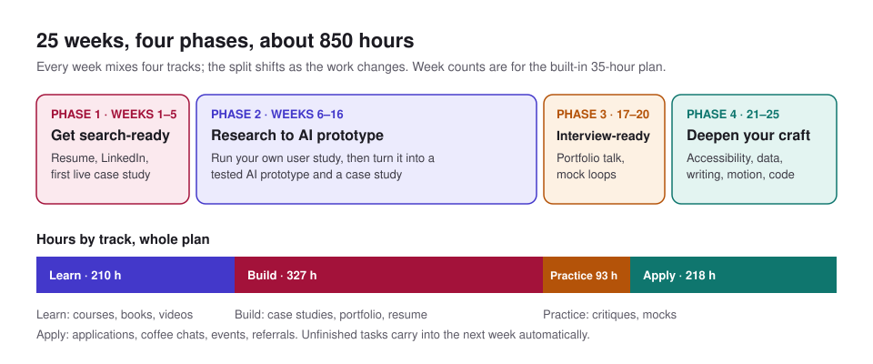
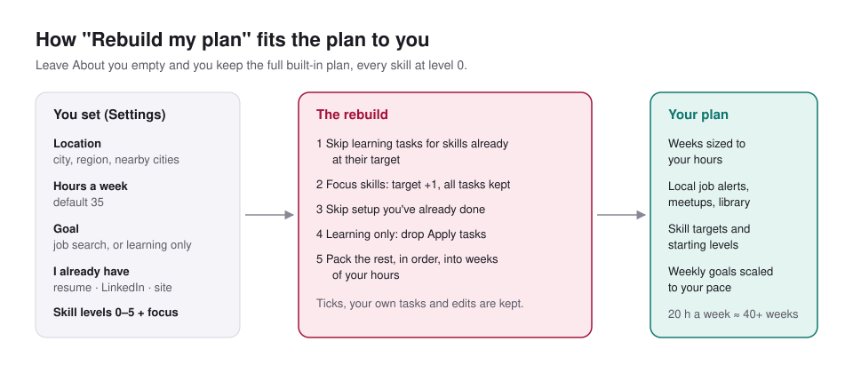
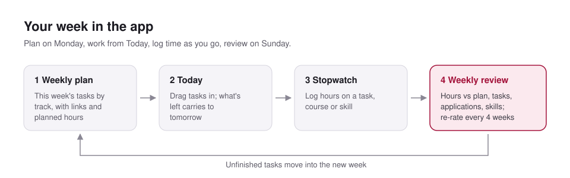
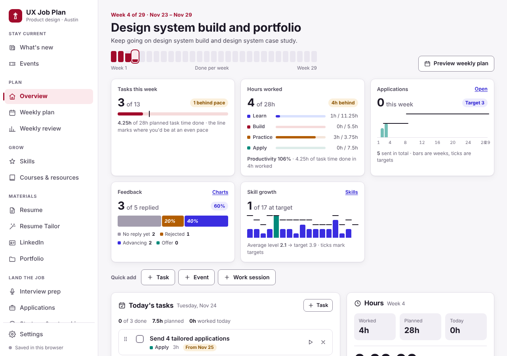
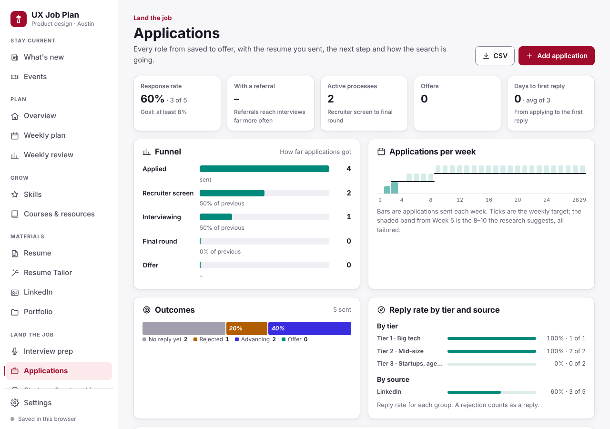
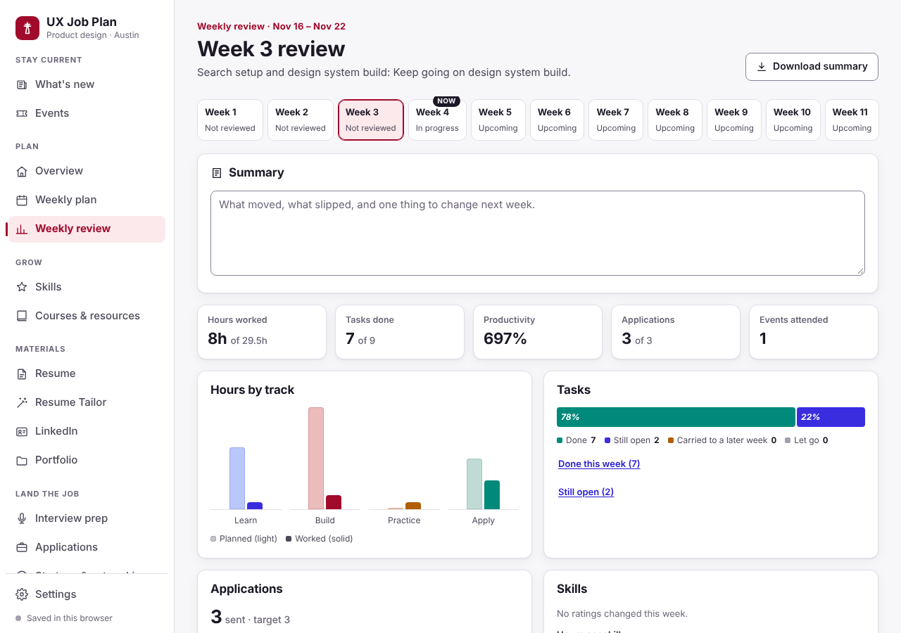
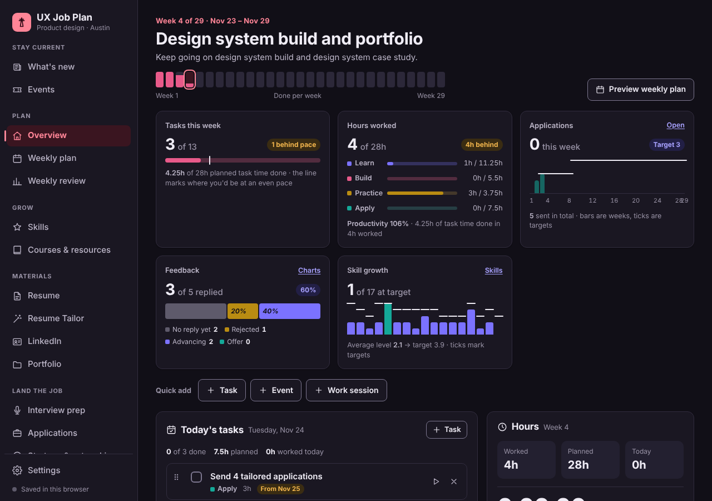

# UX Job Plan

## Watch the demo

[](ux-job-plan/review/ux-job-plan-demo.mp4)

[Watch or download the MP4](ux-job-plan/review/ux-job-plan-demo.mp4) · [English captions](ux-job-plan/review/ux-job-plan-demo.vtt)

UX Job Plan is a free, open-source browser app that turns a UX or product design job search into a weekly plan. It includes 25 weeks of courses, case-study projects, and job-search tasks, plus resume, portfolio, and interview tools. No account is required.

## How to use this tool

1. [Open UX Job Plan](https://hilalys.github.io/UXJobPlan-GitHub-edition-/) in your browser. You don't need a GitHub account, an installation, or any code. If the link shows a GitHub 404 page, the app hasn't been published yet.
2. **Start with one task.** Open **Weekly plan**, choose a task to see its steps, links, and time estimate, and check it off when you're done.
3. **Make it fit your schedule (optional).** In the app, open **Settings → About you** to set your weekly hours, goal, and skill levels. Choose **Rebuild my plan** and pick a start date. Add your city in **Settings → Location** if you want local links and events.
4. **Track your progress.** Open **Weekly review** to see what you completed. Use **Applications** to save roles and track next steps.
5. **Keep a backup.** Progress stays in the browser you use. Go to **Settings → Backup and export → Download backup** before switching browsers or clearing browser data.



## Features

| Feature | What you can do |
|---|---|
| **Weekly plan** | Follow a 25-week plan in four phases. Tasks include time estimates, links, and the skills they build. Unfinished tasks carry over. |
| **Make it yours** | Set your location, hours, goal and skill levels, then rebuild: the plan skips what you already know and fits your pace. |
| **Today and stopwatch** | Drag tasks into today's list and log time on a task, course or skill. |
| **Weekly review** | Review hours against plan, tasks done, applications, events and skills. |
| **Skills** | Track 17 product design skills with projects, practice and quick tests. Re-rate every four weeks. |
| **Courses & resources** | Explore about 130 courses, books, videos and guides tied to the plan. |
| **Resume** | Build resume versions, check that they fit on one page, and export to PDF or Word. |
| **Resume Tailor** | Paste a job post and see which keywords your resume covers. |
| **LinkedIn** | Use the profile checklist, draft posts, and track when you publish. |
| **Portfolio** | Plan case studies and track your personal site's launch checklist. |
| **Interview prep** | Review company interview loops, rehearse your portfolio presentation, and use design challenges, a story bank and timed practice. |
| **Applications and strategy** | Track roles from saved to offer, review response rates and weekly goals, and keep contacts and local design communities in view. |
| **What's new** | Browse weekly links from UX publications. Like, mark as read, or save articles to your library. |

## How it works







## Screenshots



| Weekly plan | Skills |
|---|---|
|  |  |
| **Courses & resources** | **Resume** |
|  |  |
| **Applications** | **Strategy & networking** |
|  |  |
| **Weekly review** | **Dark mode** |
|  |  |

Screenshots show demo data for a fictional designer in Austin, TX.

## Start over, reset and backup

- **Settings → Plan → Start the plan over**: a fresh Week 1 this or next Monday. Clears ticks and today's list, and optionally logged hours and reviews.
- **Settings → Reset**: reset one section, or everything.
- **Settings → Backup and export**: download a JSON backup and restore it on another device, or export CSVs.

## AI features

On GitHub Pages or localhost, go to **Settings → AI** in a [supported desktop version of Chrome](https://developer.chrome.com/docs/modern-web-guidance/guides/built-in-ai/language-model). Choose **Set up on-device AI** if Chrome needs to download its model, or turn on **AI suggestions** if it is already installed. No account or API key is needed. This is optional: the planner and weekly reading list work in other browsers too.

AI can help draft skill plans, tailor resume text, and give practice feedback. It doesn't browse the web, and drafts can be wrong, so review them before using them. Inside a Claude artifact, the existing Claude AI and scheduled feed still work when enabled there.

## Privacy

On GitHub Pages and localhost, your planner data and reading history are stored in your browser's `localStorage` (keys start with `uxjp:`). Chrome downloads its AI model once and then runs suggestions on your device. The public feed is the same for every visitor. If you instead use the app as a Claude artifact, the artifact may use your Claude account to sync data or generate suggestions.

## Run it yourself (for contributors)

ES modules don't load from `file://`, so serve the app folder from the repository root:

```bash
python3 -m http.server 8000 --directory ux-job-plan
# open http://localhost:8000
```

### GitHub Pages

From the GitHub repository, choose **Settings → Pages → Source → GitHub Actions**. Then go to **Actions → Publish UX Job Plan → Run workflow** on `main`. The workflow publishes the `ux-job-plan/` folder at `https://<user>.github.io/<repo>/`. It also runs on pushes to `main` and every Sunday. Fork owners may need to enable scheduled workflows in **Actions**.

The workflow collects public links from Nielsen Norman Group and Smashing Magazine. No job-search data is involved. If neither publisher can be reached, the workflow leaves the previous deployment in place. The local app includes starter articles without needing the workflow.

### Project layout

Paths below are relative to [`ux-job-plan/`](ux-job-plan/):

```text
index.html            app shell
css/app.css           design system and layout
js/app.js             routing, actions and events
js/store.js           state, saving, backup and restore
js/plan-data.js       the built-in 25-week plan (tasks, hours, phases)
js/personalize.js     rebuilds the plan from the profile
js/plan-tools.js      rebuild, start over, location updates
js/locale.js          location tokens ({city}, {area} ...) and location-aware links
js/content*.js        skills, resources, resume checklists, companies, interview content
js/views/*.js         one file per page
js/vendor/            embedded fonts for PDF export
docs/                 screenshots and infographics
```

## Credit and license

Made by [Hilalys](https://github.com/Hilalys). Released under the [MIT License](ux-job-plan/LICENSE): use it, change it and share it, keeping the copyright notice.
