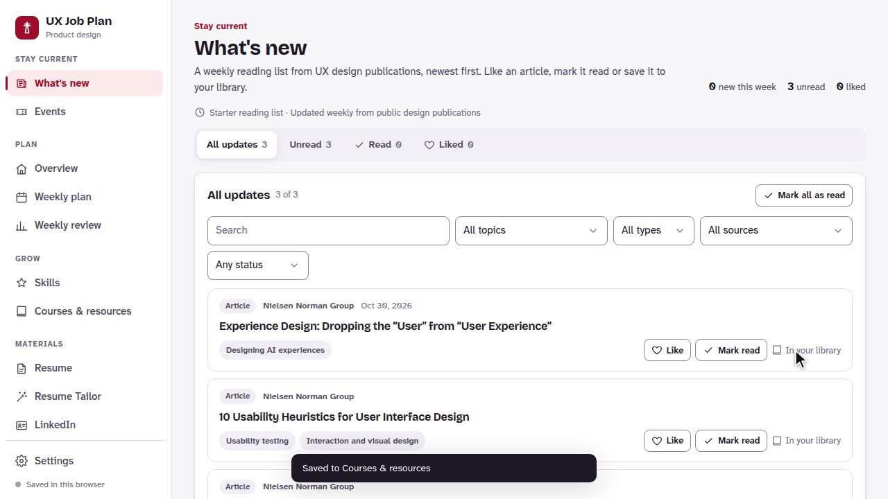

# UX Job Plan

## Watch the demo

[Watch or download the MP4](ux-job-plan/review/ux-job-plan-demo.mp4) · [English captions](ux-job-plan/review/ux-job-plan-demo.vtt)

UX Job Plan is a free, open-source browser app that turns a UX or product design job search into a weekly plan. No account is required.

[Read the project guide](ux-job-plan/README.md) for features, setup, and privacy details.
