# UX Job Plan

## Watch the demo

[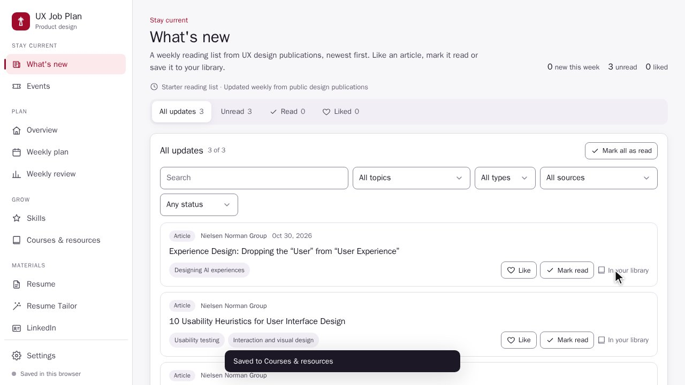](review/ux-job-plan-demo.mp4)

[Watch or download the MP4](review/ux-job-plan-demo.mp4) · [English captions](review/ux-job-plan-demo.vtt)

**A free, open-source weekly plan and job-search toolkit for UX and product designers.** 25 weeks of real courses, case-study projects and job-search tasks, a skills tracker, resume and portfolio tools, and interview prep, all in one browser app. Set your city and where you're starting from, and the plan rebuilds around you.

No account, no server, no build step. Your data stays in your browser.

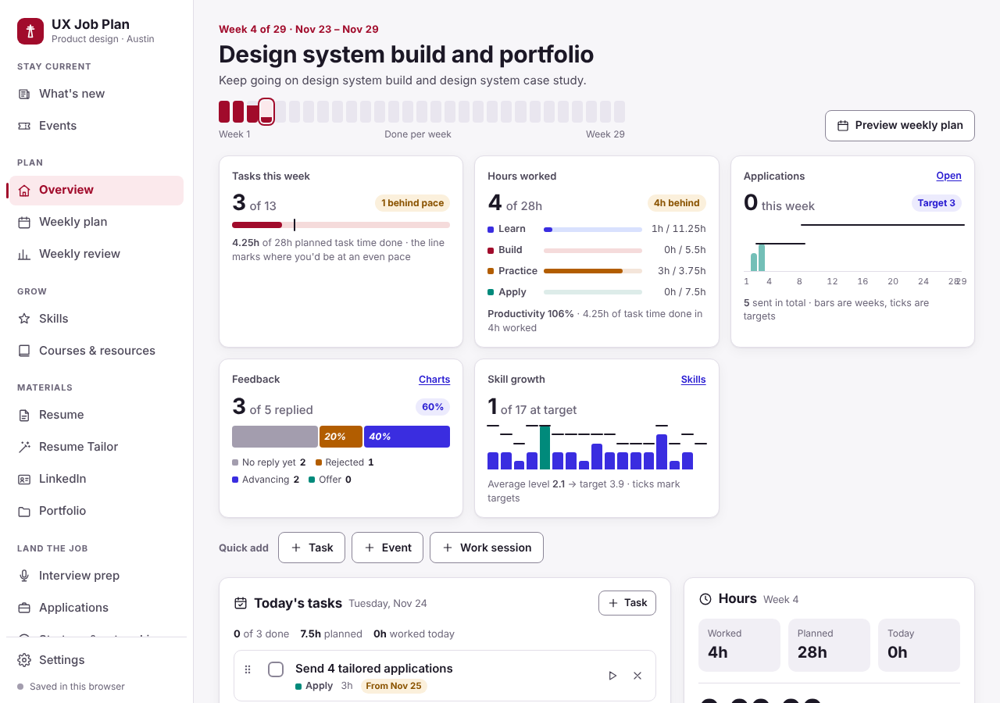

## How to use this tool

1. [Open UX Job Plan](https://hilalys.github.io/UXJobPlan-GitHub-edition-/) in your browser. No GitHub account, installation, or coding is needed. If the link shows a GitHub 404 page, the app hasn't been published yet.
2. **Pick a task.** Open **Weekly plan**, select a task to see its steps, links, and estimated time, then check it off when you're done.
3. **Personalize your plan (optional).** In the app, use **Settings → About you** to set your weekly hours, goal, and current skill levels. Choose **Rebuild my plan**, then pick a start date. If you want local links and events, add your city under **Settings → Location**.
4. **Keep track each week.** Check **Weekly review** for progress, and use **Applications** to save roles and track next steps.
5. **Keep a backup.** The app saves progress in the browser you use. Go to **Settings → Backup and export → Download backup** before switching browsers or clearing browser data.

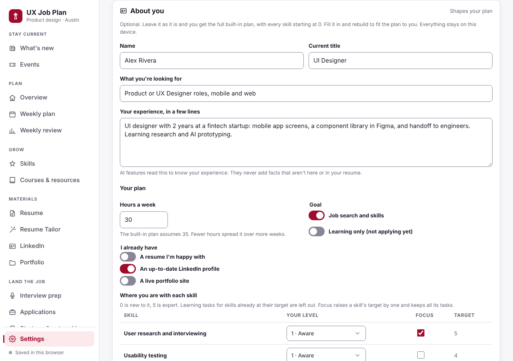

## Features

| | |
|---|---|
| **Weekly plan** | 25 weeks, about 850 hours, in four phases. Every task has its real length, links and the skills it builds. Unfinished tasks carry over. |
| **Make it yours** | Set your location, hours a week, goal and skill levels, then rebuild: the plan skips what you already know and fits your pace. |
| **Today and stopwatch** | Drag tasks into today's list and log time on a task, course or skill. |
| **Weekly review** | Hours against plan, tasks done, applications, events and skills, every week. |
| **Skills** | 17 product design skills with why each matters, how to prove it, projects, practice and quick tests. Re-rate every 4 weeks. |
| **Courses & resources** | About 130 courses, books, videos and guides, each tied to a week of the plan. |
| **Resume** | Builder with versions (master, mobile, web), one-page fit check, PDF and Word export. |
| **Resume Tailor** | Paste a job post and see which keywords your resume covers. |
| **LinkedIn** | Profile checklist with the why and how of each item, drafts and a posting rhythm. |
| **Portfolio** | Case-study planner with sections, a checklist and your personal site's launch list. |
| **Interview prep** | Company loops, portfolio presentation, design challenges, a story bank and timed practice. |
| **Applications and strategy** | Pipeline from saved to offer, response rates, tiers, weekly goals, contacts and local design communities. |
| **What's new** | Weekly links from UX publications. Like, mark as read, or save articles to your library. |

## How it works

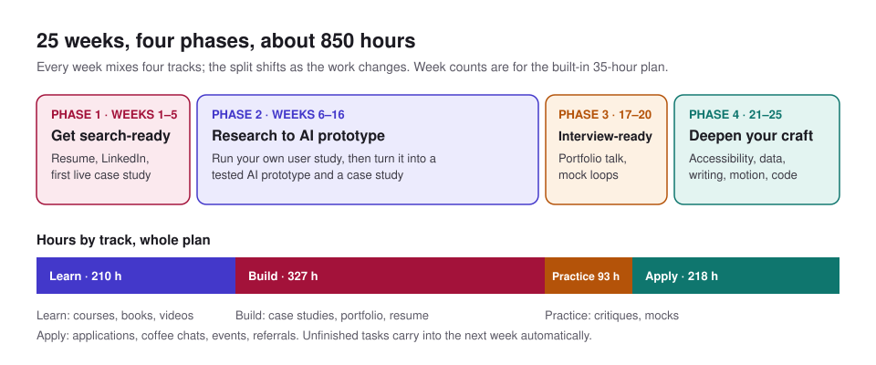

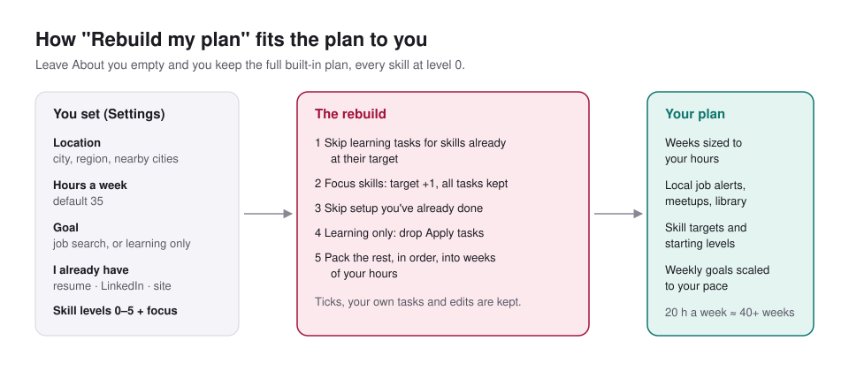

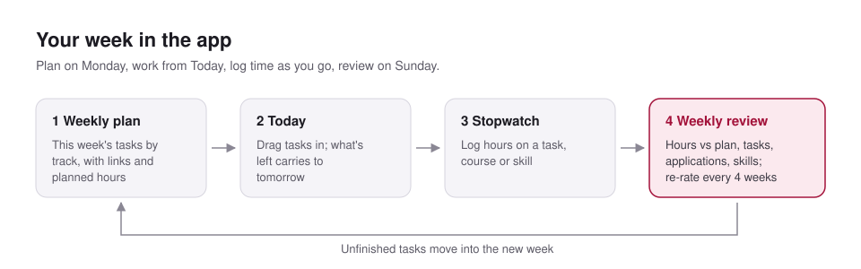

## Screenshots

| Weekly plan | Skills |
|---|---|
| 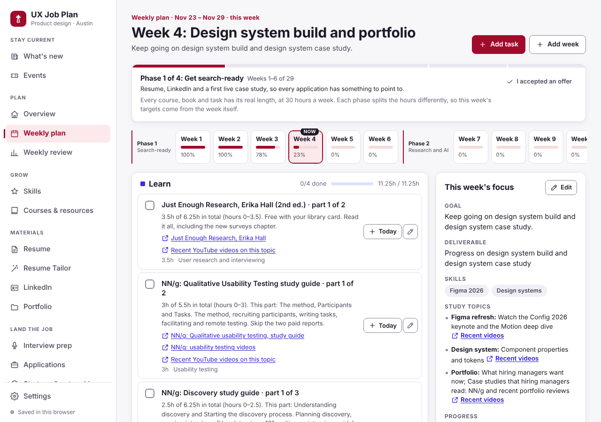 | 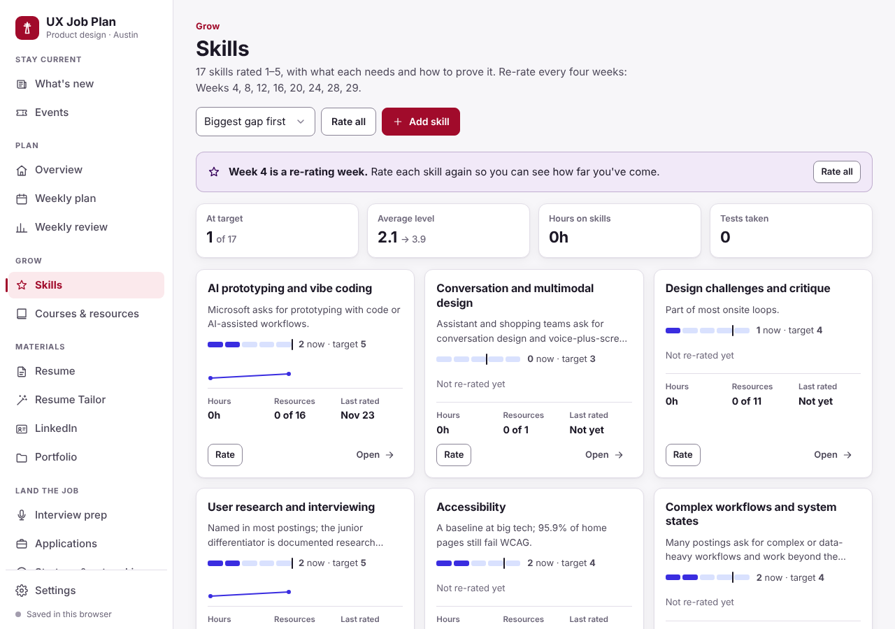 |
| **Courses & resources** | **Resume** |
| 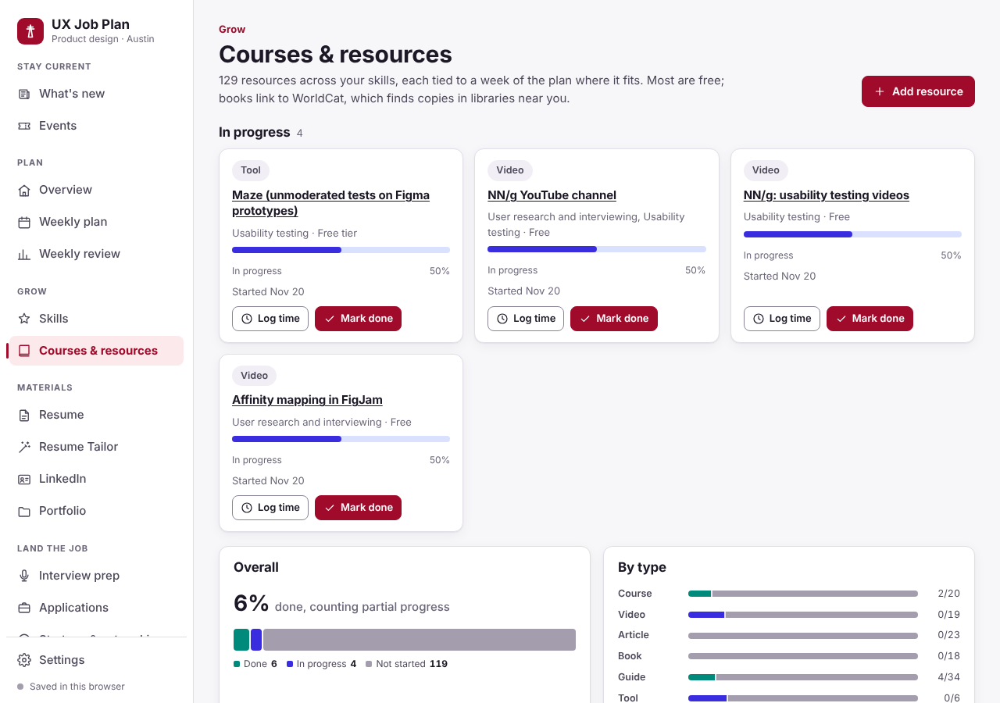 | 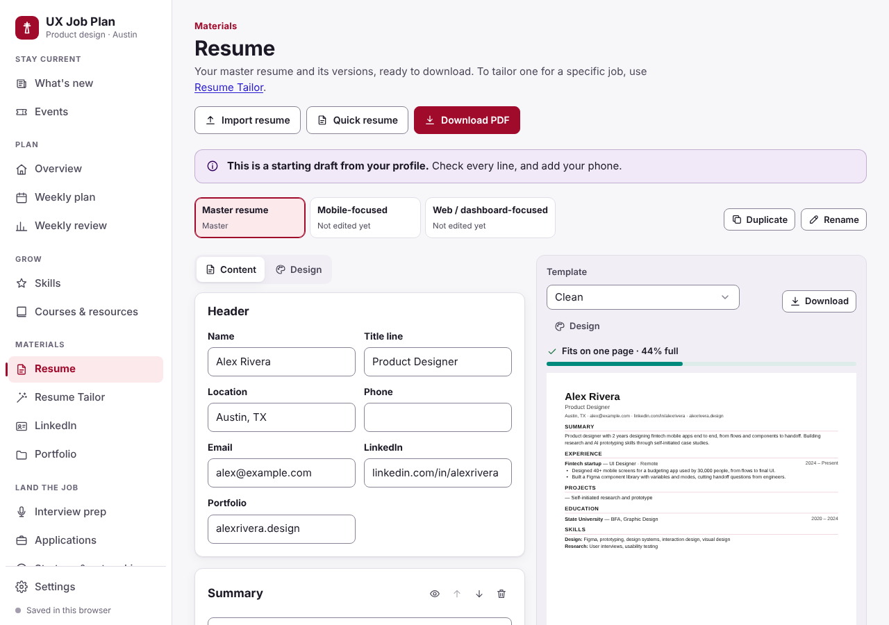 |
| **Applications** | **Strategy & networking** |
| 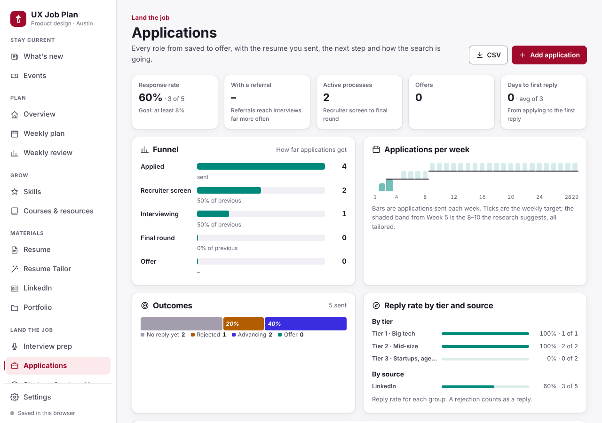 | 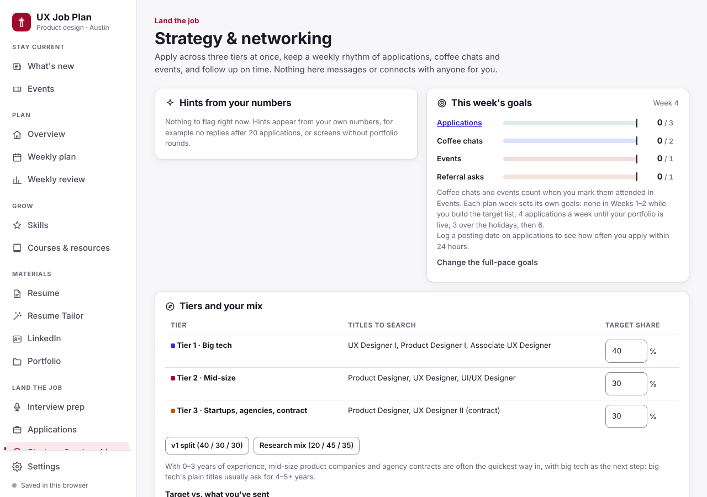 |
| **Weekly review** | **Dark mode** |
| 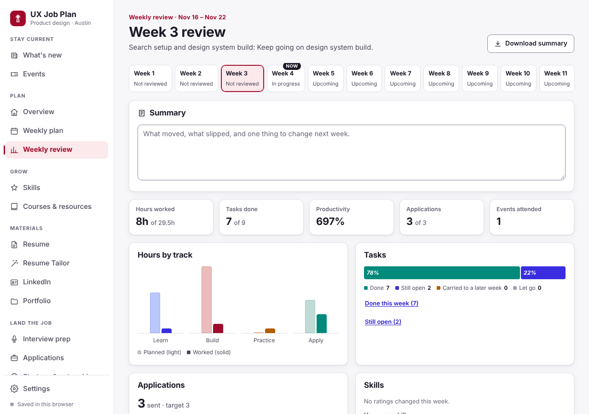 | 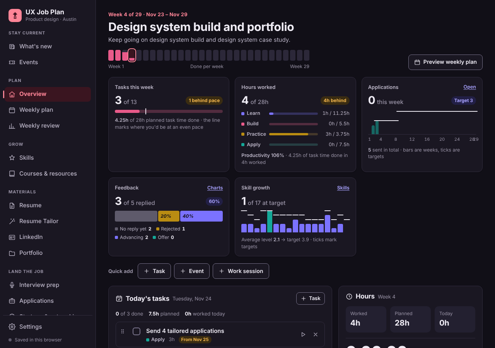 |

Screenshots show demo data for a fictional designer in Austin, TX.

## Run it yourself (for contributors)

ES modules don't load from `file://`, so serve the folder with any static server:

```bash
python3 -m http.server 8000 --directory ux-job-plan
# open http://localhost:8000
```

### GitHub Pages

From the GitHub repository, choose **Settings → Pages → Source → GitHub Actions**. Then go to **Actions → Publish UX Job Plan → Run workflow** on `main`. The workflow publishes the `ux-job-plan/` folder at `https://<user>.github.io/<repo>/`. It also runs on pushes to `main` and every Sunday. Fork owners may need to enable scheduled workflows in **Actions**.

The workflow collects public links from Nielsen Norman Group and Smashing Magazine. No job-search data is involved. If neither publisher can be reached, the workflow leaves the previous deployment in place. The local app includes starter articles without needing the workflow.

## Start over, reset and backup

- **Settings → Plan → Start the plan over**: a fresh Week 1 this or next Monday. Clears ticks and today's list, and optionally logged hours and reviews.
- **Settings → Reset**: reset one section, or everything.
- **Settings → Backup**: download a JSON backup and restore it on another device, or export CSVs.

## AI features

On GitHub Pages or localhost, go to **Settings → AI** in a [supported desktop version of Chrome](https://developer.chrome.com/docs/modern-web-guidance/guides/built-in-ai/language-model). Choose **Set up on-device AI** if Chrome needs to download its model, or turn on **AI suggestions** if it is already installed. No account or API key is needed. This is optional: the planner and weekly reading list work in other browsers too.

AI can help draft skill plans, tailor resume text, and give practice feedback. It doesn't browse the web, and drafts can be wrong, so review them before using them. Inside a Claude artifact, the existing Claude AI and scheduled feed still work when enabled there.

## Privacy

On GitHub Pages and localhost, your planner data and reading history are stored in your browser's `localStorage` (keys start with `uxjp:`). Chrome downloads its AI model once and then runs suggestions on your device. The public feed is the same for every visitor. If you instead use the app as a Claude artifact, the artifact may use your Claude account to sync data or generate suggestions.

## Project layout

```
index.html            app shell
css/app.css           design system and layout
js/app.js             routing, actions and events
js/store.js           state, saving, backup and restore
js/plan-data.js       the built-in 25-week plan (tasks, hours, phases)
js/personalize.js     rebuilds the plan from the profile
js/plan-tools.js      rebuild, start over, location updates
js/locale.js          location tokens ({city}, {area} …) and location-aware links
js/content*.js        skills, resources, resume checklists, companies, interview content
js/views/*.js         one file per page
js/vendor/            embedded fonts for PDF export
docs/                 screenshots and infographics
```

## Credit and license

Made by [Hilalys](https://github.com/Hilalys). Released under the [MIT License](LICENSE): use it, change it and share it, keeping the copyright notice.
